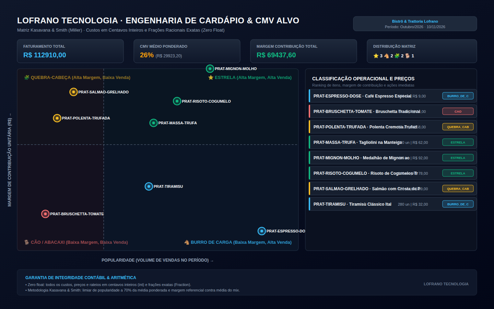

# precificacao-cardapio-cmv

[](https://github.com/martinlofranodeoliveira/precificacao-cardapio-cmv/actions/workflows/ci.yml)
[](https://www.python.org/)
[](LICENSE)
[-brightgreen.svg)](pyproject.toml)
[](https://github.com/martinlofranodeoliveira)

Engenharia de Cardápio (*Menu Engineering*), Ficha Técnica Gastronômica Operacional, Custo de Mercadorias Vendidas (CMV Alvo) e Matriz de Rentabilidade Kasavana & Smith (Miller).

Desenvolvido para restaurantes, bares, cafeterias, confeitarias e operações de *food service* que exigem rigor contábil absoluto e decisões baseadas em dados reais de vendas e custos de matéria-prima.



---

## Destaques e Pilares Técnicos

- **Zero Dependências Externas em Execução**: Opera exclusivamente com os módulos nativos da biblioteca padrão do Python (`math`, `fractions`, `json`, `sqlite3`, `zipfile`). Compatível com Python 3.11, 3.12, 3.13 e 3.14.
- **Aritmética Inteira e Racional Exata (Zero Float)**:
  - Valores monetários gerenciados estritamente em **centavos inteiros** (`int`), eliminando imprecisões e erros cumulativos de ponto flutuante IEEE-754.
  - Grandezas de insumos em unidades inteiras (gramas, mililitros ou unidades discretas).
  - Fatores de correção ($FC = \text{Peso Bruto} / \text{Peso Líquido}$) e taxas tributárias modelados por razões exatas (`fractions.Fraction`).
  - Arredondamento contábil com proteção de teto (`ceil`) para evitar subdimensionamento do custo de alimentos (*food cost buffer*).
- **Matriz de Engenharia de Cardápio (Kasavana & Smith / Miller)**:
  - **⭐ Estrela (Star)**: Alta popularidade e Alta margem de contribuição.
  - **🐴 Burro de Carga (Plowhorse)**: Alta popularidade e Baixa margem de contribuição.
  - **🧩 Quebra-Cabeça (Puzzle)**: Baixa popularidade e Alta margem de contribuição.
  - **🐕 Cão / Abacaxi (Dog)**: Baixa popularidade e Baixa margem de contribuição.
  - Limiar de popularidade a $70\%$ da média esperada do mix ($10 \cdot N \cdot v_i \ge 7 \cdot V_{tot}$) e margem de contribuição de corte avaliada contra a média ponderada global.
- **Segurança e Conformidade**:
  - Codec JSON canônico com rejeição estrita de BOM (`\xef\xbb\xbf`), chaves duplicadas e recursão excessiva ($> 32$ níveis).
  - Sanitização de CSV contra injeção de fórmulas (*spreadsheet injection* com prefixo de aspa simples em `=`, `+`, `-`, `@`, `\t`, `\r`).
  - Geração de pacote ZIP determinístico e bit-a-bit reproduzível com proteção atômica contra sobrescrita (`os.O_EXCL`).
- **Verificador Independente em SQLite**:
  - Script autônomo em `tools/verify_independent.py` que valida a consistência de cada ficha e classificação relacional via `sqlite3` em memória sem importar o código da aplicação.

---

## Instalação

Como o pacote não possui dependências externas, você pode instalá-lo diretamente via pip a partir do repositório ou empacotar via flit:

```bash
pip install git+https://github.com/martinlofranodeoliveira/precificacao-cardapio-cmv.git
```

Ou clonar e executar localmente:

```bash
git clone https://github.com/martinlofranodeoliveira/precificacao-cardapio-cmv.git
cd precificacao-cardapio-cmv
```

---

## Uso via Linha de Comando (CLI)

### 1. Exportar modelo de cardápio canônico
```bash
precificacao-cardapio exemplo --saida cardapio.json
```

### 2. Analisar custos, CMV e gerar relatórios
```bash
precificacao-cardapio analisar cardapio.json --saida-dir relatorios/ --zip pacote-auditoria.zip
```

Arquivos gerados no diretório de saída:
- `analise_cardapio.json`: Resumo canônico completo com CMV atual, CMV alvo e métricas por item.
- `fichas_tecnicas.csv`: Planilha higienizada com custos unitários, preços sugeridos e quadrante.
- `insumos.csv`: Cadastro de matérias-primas e fatores de correção.
- `relatorio.md`: Relatório executivo com plano de ação estratégico por quadrante.
- `painel.svg`: Painel vetorial analítico (1440×900) contendo o *scatter plot* da Matriz Kasavana & Smith e tabela lateral.

---

## Uso como Biblioteca Python

```python
from precificacao_cardapio import (
    carregar_cardapio,
    calcular_ficha,
    classificar_cardapio,
    Quadrante,
)

# 1. Carregar arquivo canônico
cardapio = carregar_cardapio("exemplares/cardapio_restaurante.json")

# 2. Calcular custos e precificação por ficha técnica
fichas_calculadas = [
    calcular_ficha(ficha, cardapio.insumos)
    for ficha in cardapio.fichas
]

# 3. Classificar na Matriz Kasavana & Smith
analise = classificar_cardapio(
    estabelecimento=cardapio.nome_estabelecimento,
    periodo=cardapio.periodo,
    fichas_calculadas=fichas_calculadas,
)

print(f"Faturamento Total: R$ {analise.faturamento_total_centavos / 100:.2f}")
print(f"CMV Médio: {analise.cmv_medio_ponderado_frac.numerator * 100 // analise.cmv_medio_ponderado_frac.denominator}%")

for item in analise.itens:
    print(f"- {item.ficha.nome}: {item.quadrante.value} (Margem: R$ {item.ficha.margem_contribuicao_centavos / 100:.2f})")
```

---

## Estrutura do Formato JSON Canônico

```json
{
  "nome_estabelecimento": "Bistrô & Trattoria Lofrano",
  "periodo": "Outubro/2026",
  "insumos": [
    {
      "codigo": "INS-FIL-MIGNON",
      "nome": "Filé Mignon Bovino Limpo",
      "unidade": "g",
      "quantidade_embalagem": 1000,
      "custo_embalagem_centavos": 7800,
      "fator_correcao_num": 110,
      "fator_correcao_den": 100
    }
  ],
  "fichas": [
    {
      "codigo": "PRAT-MIGNON-MOLHO",
      "nome": "Medalhão de Mignon ao Poivre",
      "categoria": "Pratos Principais",
      "rendimento_porcoes": 1,
      "custo_embalagem_centavos": 200,
      "preco_venda_centavos": 9200,
      "vendas_periodo": 410,
      "cmv_alvo_num": 30,
      "cmv_alvo_den": 100,
      "taxas_impostos_num": 12,
      "taxas_impostos_den": 100,
      "ingredientes": [
        { "codigo_insumo": "INS-FIL-MIGNON", "quantidade_liquida": 220 }
      ]
    }
  ]
}
```

---

## Verificação e Testes

Execute a suíte de 55 testes unitários automatizados:

```bash
python -m unittest discover -s tests -v
```

Execute o oráculo contábil independente via SQLite:

```bash
python tools/verify_independent.py exemplares/cardapio_restaurante.json
```

---

## Licença

Distribuído sob a licença **MIT**. Consulte o arquivo [LICENSE](LICENSE) para maiores detalhes.

**LOFRANO TECNOLOGIA** — Software sob medida e engenharia de alta confiabilidade.
